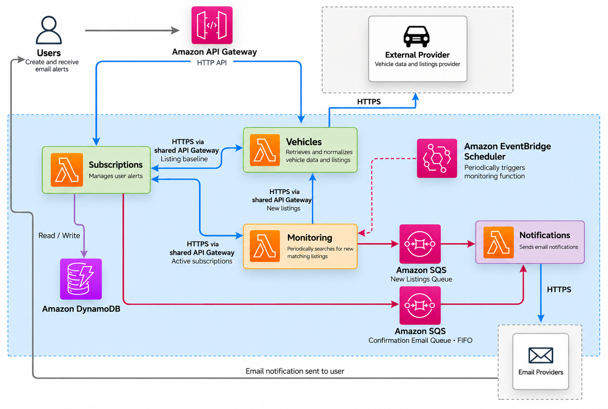

# Prices Car Watch

A serverless vehicle listing monitoring application built on AWS that notifies users when new cars matching their search criteria become available.

## Overview

**Prices Car Watch** helps users monitor vehicle listings and receive notifications when new matches appear.

Users can create alerts based on make, model, version, year, and location. Once an alert is confirmed, the application captures the existing listings as its initial baseline and only notifies the user about newly discovered ones.

The application periodically searches for matching listings according to a schedule managed by Amazon EventBridge Scheduler. When new matches are detected, it sends the user an email containing the new listings.

Currently, the project uses Webmotors, a Brazilian vehicle marketplace, as its data source. This integration is isolated from the application’s core domain, allowing other providers, such as auto.dev or similar APIs, to be added without changing the business logic.

The same extensible approach is used for email delivery. Mailjet is used by the current AWS deployment, while the application also includes support for Brevo. Additional email providers can be introduced without affecting the notification workflow.

## Architecture and Design Principles

Prices Car Watch follows a serverless microservices architecture that combines synchronous APIs with asynchronous, event-driven workflows.

The application is divided into four independently deployable services—Vehicles, Subscriptions, Monitoring, and Notifications—each organized around a specific business capability.

  

- **Serverless:** The application runs on managed AWS services such as Lambda, API Gateway, DynamoDB, SQS, EventBridge Scheduler, ECR, CloudWatch, and Secrets Manager. This reduces operational overhead and allows each component to scale independently.

- **Event-driven processing:** EventBridge Scheduler triggers periodic monitoring, while SQS decouples email delivery from the rest of the application. Queues provide asynchronous processing and retry support, with a dead-letter queue protecting the new-listing notification workflow.

- **Microservices:** Each service owns a specific business capability and can be developed, tested, deployed, and evolved independently.

- **Ports and adapters:** Business logic depends on abstractions instead of external providers. Integrations such as Webmotors, Mailjet, and Brevo are implemented as replaceable adapters.

- **Synchronous and asynchronous communication:** HTTP APIs are used when an immediate response is required, while queues and scheduled events handle background workflows.

## Observability

Observability is built into every service through structured logging, distributed correlation, and business-level metrics:

- **Structured logs:** Services emit JSON logs enriched with timestamps, service names, request or message identifiers, execution duration, error details, and retry attempts.

- **End-to-end correlation:** Correlation IDs are propagated across HTTP requests and SQS messages, making it possible to trace a workflow across service boundaries.

- **Custom metrics:** AWS Lambda Powertools publishes metrics to CloudWatch under the `PricesCarWatch` namespace, covering vehicle queries, subscription activity, monitoring runs, newly detected listings, published notifications, successful deliveries, and delivery failures.

- **Managed log retention:** Terraform provisions CloudWatch log groups for every Lambda function and API Gateway, with explicit retention policies and structured API access logs.

## Infrastructure and Delivery

The AWS infrastructure is defined with Terraform and organized into separate ECR and application stacks. Both stacks use encrypted remote state stored in Amazon S3.

GitHub Actions automates validation and deployment:

- **Continuous integration:** Pull requests and pushes to `main` run the test suite for each service in parallel, check Terraform formatting, and validate both infrastructure stacks.

- **Continuous deployment:** Pushes to `main` build a Docker image for each service, tag it with the commit SHA, publish it to Amazon ECR, and deploy the application with Terraform. The workflow can also be triggered manually.

  The current pipeline deploys all services together for simplicity, although each service can be deployed independently.

- **Secure AWS authentication:** The deployment workflow uses GitHub Actions OIDC to assume an AWS IAM role, avoiding long-lived AWS credentials in the repository.

## Deployment Prerequisites

The deployment pipeline requires:

- An S3 bucket for the Terraform remote state. Set its name as the GitHub Actions variable `TF_STATE_BUCKET`.
- An AWS IAM role configured with GitHub as an OIDC provider and trusted by this repository. Set its ARN as the GitHub Actions secret `AWS_ROLE_TO_ASSUME`.
- Optionally, set the GitHub Actions variable `AWS_REGION`. It defaults to `sa-east-1`.

Once these prerequisites and the required deployment variables are configured, pushing the project to `main` triggers the pipeline, which provisions the infrastructure, builds and publishes the service images, and deploys the complete application automatically.
